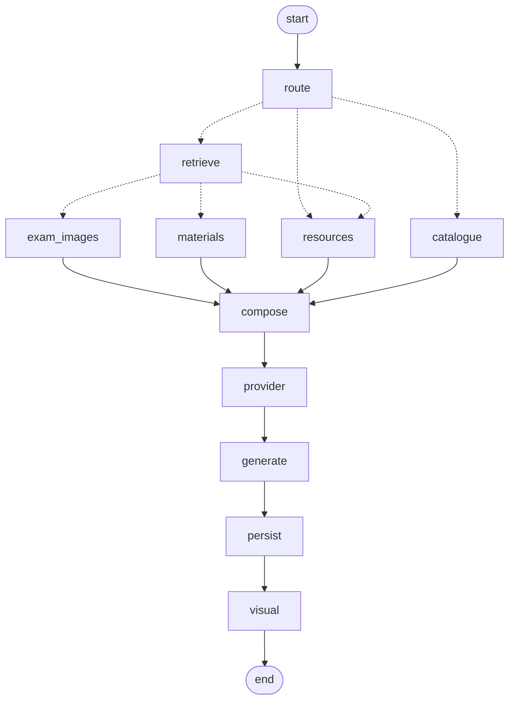

# SPM AI Tutor

A retrieval-augmented AI tutor for Malaysian **SPM / KSSM** secondary-school students (Form 4–5), covering Additional Mathematics, Mathematics, Physics, Chemistry and Sejarah (History) in both **English and Malay**.

Students ask questions in plain language, upload a photo of their homework, or ask for past-year exam questions. The tutor answers **only from the material it retrieves**: KSSM textbooks, past-year trial papers and their teachers' uploaded class notes. A student can therefore see where every fact came from. Teachers upload their own notes, which the tutor then teaches from as the authoritative source.

> **Stack:** TypeScript · Fastify · React + Vite + Tailwind · Supabase Postgres + pgvector · LangGraph · Claude Sonnet 5 (tutor) · GPT-4.1 (OCR / chunking) · multilingual-e5 embeddings (local) · Langfuse tracing · Railway

---

## What it does

- **Strictly grounded tutoring.** The tutor may *apply* a retrieved method to the student's own numbers, but it may not assert a formula, date or definition that isn't in the retrieved material. When nothing relevant is found, it says so instead of answering from memory.
- **Bilingual retrieval across a language-partitioned corpus.** Maths and Physics sources are in English; Sejarah and most teacher notes are in Malay. A query-side glossary rewrites Malay curriculum terms so a Malay question can still reach English material.
- **Past-year questions by exam.** "Soalan percubaan fizik Kedah 2025 tentang gelombang" goes through an exact filter on exam year and state, not a similarity search. "Johor 2013" therefore gets an honest *"I have 2021–2023, not 2013"* instead of a near-miss from another paper.
- **The real diagram, not a redrawn one.** Many exam questions depend on a diagram that text can't capture. The tutor is shown the original rendered exam page and shows it to the student, cropped to the figure.
- **Teacher materials.** Teachers upload PDFs, which are always vision-OCR'd because slide decks hide diagrams as images. The tutor teaches from them, and the source files appear in a side panel when an answer drew on them.
- **Guide, don't tell.** Students are coached through calculations and homework with hints that escalate. Concepts and definitions are taught in full. Teachers get full worked solutions and marking schemes immediately.
- **Multiple model providers.** Claude, GPT or a Malaysian LLM can be chosen per conversation, with a per-student daily spending cap enforced from real token costs.
- **Image and PDF attachments.** A student can photograph a question and ask about it.

## Architecture

Each chat turn runs as a **LangGraph state graph**:



| Node | Job |
|---|---|
| `route` | Classifies the turn (schoolwork / small talk / off-topic / app help / "what do you have"). Cheap rules run first, then a forced tool call. In parallel it rewrites the follow-up as a standalone question and detects file requests. |
| `retrieve` | Up to seven parallel lanes merged into a 12-chunk context: hybrid BM25 + vector search (RRF), the Malay→English rewrite, the standalone rewrite, teacher materials (vector + an LLM relevance judge), teacher keyword search (IDF) and the exam-label filter. |
| `exam_images` | Finds which retrieved exam questions need their diagram, locates the figure on the stored page image and crops it. |
| `materials` | Decides which teacher files to list beside the answer. This uses a stricter relevance test than the one for admitting context. |
| `catalogue` | Answers "how many Chemistry topics do you have?" from the database rather than from whatever retrieval happened to return. |
| `generate` → `persist` → `visual` | Calls the chosen provider, saves the turn, and draws a diagram only when the student asked for one. |

The chat logic lives once, in `src/lib/chat-handler.ts`. It has two entry points: a **Fastify server** for production (`src/server.ts`) and a **Vite dev-server plugin** (`frontend/vite-plugins/api.ts`) that serves the UI and the API on one port for local development.

### Ingestion pipeline

```
PDF ─► text layer (pdf-parse)  or  page render (pdftoppm) + GPT-4.1 vision OCR
    ─► 6-page batches ─► GPT-4.1 chunker → typed chunks
       (concept · worked_example · past_year_question · formula · common_mistake)
    ─► multilingual-e5-base embedding (local, int8) ─► Postgres / pgvector
```

- The chunker must keep a worked example together with its solution, even when the solution is on a later page.
- The chunker may never invent an answer to fill a gap. Every chunk is tagged with whether its answer came from the source.
- Answer keys printed in a separate file are matched to their questions **in code**, never by the model. When the model was asked to do the matching, it renumbered the questions in every batch and attached 338 plausible-looking wrong answers.

## Engineering decisions, with measurements

Every tuning decision was measured against the real knowledge base before shipping. The details sit next to each constant in the code.

| Problem | What was measured | Outcome |
|---|---|---|
| Retrieval quality | 47-item golden set, Recall@5 / MRR | Baseline **0.708 / 0.648** → **0.872 / 0.766** after removing book front/back matter, adding hybrid BM25 + vector search with RRF fusion, and repairing broken maths glyphs in the PDF text layer |
| A similarity cutoff for teacher notes | Distribution of relevant vs irrelevant chunks | The ranges overlapped completely (relevant as low as 0.744, irrelevant up to 0.869), so no single cutoff works. Replaced with an **LLM relevance judge** that falls back safely on error |
| Malay questions reaching English sources | Hits per query, by language | "pembezaan" (differentiation) returned **0/6** Add Maths chunks. The query glossary improved **6 of 13** test queries and made **0** worse |
| "Guide, don't tell" over-applied | Full pipeline on the 119-item golden set | Correctness **0.643 → 0.752** and faithfulness **0.854 → 0.904** once coaching was limited to work the student should do themselves |
| File-request detection | Paraphrased requests in English and Malay | A keyword list kept missing new phrasings. A model-decided tool call scored **12/12** on two runs, including requests with no file keyword at all |
| Judging answers reliably | One judge, re-run on the same answers | A single pass/fail verdict flipped on 11 of 82 answers between runs. A claim-by-claim judge whose quotes are checked in code gives stable scores |

Evaluation lives in `src/rag/` (retrieval and answer evaluation, LLM-as-judge with claims checked in code) and `src/scripts/golden-*.ts` (golden-set drafting, checking and upload to Langfuse). `RAG_STATUS.md` logs every experiment and its verdict.

## Project structure

```
src/
  lib/        chat handler, LangGraph turn graph, router, retrieval, providers, auth, usage caps, tracing
  rag/        evaluation harness, hybrid search, index building, rerank experiments
  ingest/     PDF → chunks → embeddings pipeline, past-year OCR pipelines
  scripts/    one-off backfills, migrations, eval and golden-set tooling
  routes/     thin Fastify route wrappers
frontend/     React + Vite + Tailwind chat UI (KaTeX maths, file panel, teacher upload)
sql/          schema and migrations (pgvector, HNSW, BM25 / tsvector, retrieval RPCs)
docs/         turn-graph diagram (Mermaid)
```

## Running locally

Requires **Node 22+** and a Supabase project with pgvector. `pdftoppm` (poppler) is only needed to OCR scanned PDFs.

```bash
# 1. Install
npm install
npm --prefix frontend install

# 2. Configure
cp .env.example .env
#    SUPABASE_URL, SUPABASE_SERVICE_ROLE_KEY, OPENAI_API_KEY, ANTHROPIC_API_KEY,
#    plus VITE_SUPABASE_URL and VITE_SUPABASE_ANON_KEY for the frontend

# 3. Database: run sql/schema.sql, then the sql/migrate_*.sql files, in the Supabase SQL editor

# 4. Run UI + API together on http://localhost:5173
cd frontend && npm run dev
```

> **Windows:** `npm run dev` calls a Unix shell shim. Run Vite's entry directly instead:
> `node --env-file=../.env node_modules/vite/bin/vite.js` (from `frontend/`).

Other commands (from the repo root):

```bash
npm run dev         # standalone Fastify API (production shape)
npm run typecheck   # tsc --noEmit
npm run ingest -- <file.pdf> --exam-board SPM --subject 'Physics' --topic Electricity [--vision] [--dry-run]
npm run router:graph  # print the turn graph as Mermaid
```

## Notes

- The golden evaluation sets, run reports and retrieval set are **not included**. They contain real student questions and licensed course material. The evaluation and ingestion code that produced them is included.
- Students' questions and answers are traced to Langfuse for review. Images are stripped before export, because the users are school students.
- `CLAUDE.md` holds the long-form design notes: why each decision was made, what was tried and rejected, and the measurements behind it.
